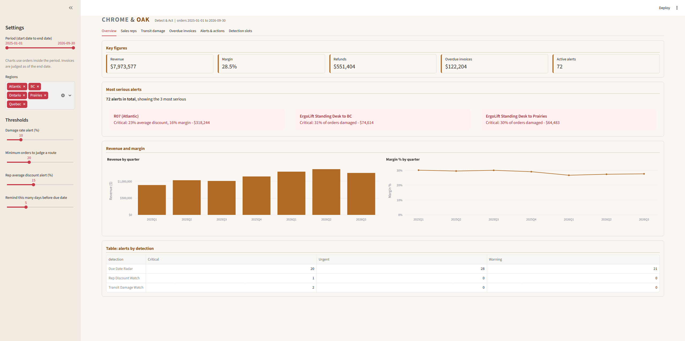

# Chrome & Oak Action Center

A sales and finance dashboard that watches data, flags the situations that cost money, and drafts the fix.

Built in 4 hours by a team of 2 for the Business Track (Option B: Sales & Finance) at Hack 2 the Future 2026.

<p align="center">
  
</p>

<p align="center">
  <em>The Overview tab: key figures, the most serious alerts, and revenue vs margin by quarter.</em>
</p>

---

## Contents

- [The problem](#the-problem)
- [What we found](#what-we-found)
- [What the app does](#what-the-app-does)
- [Tabs](#tabs)
- [Quick start](#quick-start)
- [The data](#the-data)
- [Assumptions and limits](#assumptions-and-limits)
- [What we'd build next](#what-wed-build-next)
- [Repository layout](#repository-layout)
- [Team](#team)

---

## The problem

On paper, Chrome & Oak Office Supply has never looked better: revenue is up 33% year over year (Jan to Sep). Underneath, the leadership team is describing symptoms that don't match the headline.

| Who | What they said | What the data says |
|---|---|---|
| CEO | "Revenue is up about a third. Atlantic punches above its weight." | Revenue is up 33%, but **margin is up only 21%**, and Atlantic's growth comes with the thinnest margins in the company. |
| CFO | "Revenue is growing but profit isn't keeping up, and I'm chasing unpaid invoices." | Margin fell from 29.9% to 27.2% of revenue. 92 invoices ($250K) are unpaid, 54 of them overdue ($135K). |
| Operations | "Returns are eating my warehouse team's time, especially the big items." | One product, the ErgoLift Standing Desk, is behind 79 of 103 damaged-in-transit returns. |
| Customer Success | "Long-time business customers have gone quiet." | Regular customers who received a damaged delivery are about 3x more likely to stop ordering. |

We chose to solve damage in transit first. It is concentrated, measurable, and fixable by one team, and it shows up in refunds, warehouse workload, and lost customers all at once.

## What we found

1. Revenue is growing faster than profit. Jan to Sep 2026 vs 2025: revenue +33%, margin +21%.
2. One rep drives the margin gap. R07 (Atlantic) is the top seller at $1.98M but discounts 23% on average, while every other rep sits at 8 to 11%. R07's margin is 16%, against 31 to 34% for the rest. All 40 loss-making orders belong to R07, and all 46 "Overstock / ordered in error" returns ($150K) trace back to R07 reseller orders.
3. Damage is a desk problem in two regions. ErgoLift Standing Desks are damaged in about 31% of BC orders and 30% of Prairies orders, against 5 to 9% in Ontario, Quebec, and Atlantic. Desks account for $248K of the $269K refunded for transit damage.
4. Damage costs customers, not just refunds. Among business customers with 5+ orders, 34% of those who received a damaged delivery have gone 90+ days without ordering, against 10% of those who didn't. This is a strong association, not proof of cause.
5. Chasing invoices is a time problem. 92 business invoices ($250K) are unpaid and 54 are overdue ($135K). Pursuing these by hand is slow, so the app drafts a reminder for every invoice that is due soon or overdue, and opens it in Outlook with one click.

## What the app does

The Action Center follows the challenge flow:

```
DATA  →  DETECT  →  DECIDE  →  ACT
```

Each detection produces an alert with a **level** (Warning, Urgent, or Critical), a **recommended action**, and **who should be told**. Automations then act on those alerts.

### Detections

| Detection | Rule | Levels | Who is told |
|---|---|---|---|
| **Transit Damage Watch** (primary) | A product/region pair has more than 10% of orders damaged in transit, with at least 20 orders | Urgent; Critical above 2x the threshold | Operations Manager |
| **Due Date Radar** | Business invoice due within 5 days, or already overdue | Warning (due soon); Urgent (1 to 30 days overdue); Critical (30+ days overdue) | Accounts receivable and the account rep |
| **Rep Discount Watch** | A sales rep's average discount on business orders is above 15% | Urgent; Critical above 2x the typical rep | CFO and Head of Sales |
| **Credit Limit Guard** | Open invoices at 75% (warning) or 90% (urgent) of a customer's credit limit | Warning, Urgent, Critical | CFO and the account rep |

Credit Limit Guard is written but **paused**: only one customer is near its limit, so we kept the focus on damage and overdue invoices. The credit-usage chart still appears on the invoices tab.

### Automations

| Automation | What it does |
|---|---|
| **Alert Log** | Every new alert is written once to `alerts_log.csv` with a timestamp, the recommended action, and who is notified. No clicks needed. |
| **Payment Reminder Drafts** | Every Due Date Radar alert gets a reminder drafted automatically, with a friendlier tone for upcoming invoices and a firmer one for overdue ones. One click opens the draft in Outlook (desktop or web); the employee reviews it and clicks Send. All drafts can also be downloaded as a CSV. |

**Nothing is sent by the app itself.** A person reviews every message in Outlook before it goes out.

**What if an alert is wrong?** The thresholds are adjustable in the sidebar (damage rate, minimum orders per route, rep discount, and days before due date), and every alert is logged so false alarms can be traced and the rules tuned.

**Simulation:** move the period slider to change the as-of date, or change any threshold, and watch which alerts appear and disappear. New alerts are logged as they appear.

## Tabs

| Tab | What it shows |
|---|---|
| **Overview** | Key figures (revenue, margin, refunds, overdue invoices, active alerts), the most serious alerts, and revenue and margin by quarter |
| **Sales reps** | Rep Discount Watch: revenue, average discount, and margin per rep, company margin with and without the flagged rep, and loss-making orders and overstock returns |
| **Transit damage** | Damage-rate heatmap by product and region, damage rate by region for a chosen product, refunds by product, and the link between damaged deliveries and customers who stopped ordering |
| **Overdue invoices** | Overdue amounts by terms (Net 30 / Net 60), invoice aging, top overdue customers, credit usage, the invoice list, and the reminder drafts |
| **Alerts & actions** | The alert log, filterable by level, with a chart and table per active detection |
| **Detection slots** | The registry of every detection and automation, built or not |

The sidebar holds the period, region filter, and all thresholds.

## Quick start

```bash
git clone <repo-url>
cd <repo-name>
pip install -r requirements.txt
streamlit run app.py
```

Requires Python 3.10+. Built with `pandas`, `plotly`, and `streamlit`. `orders_clean.csv` must sit in the same folder as `app.py`.

**Windows: "`streamlit` is not recognized"?** Pip may have installed Streamlit somewhere that isn't on your PATH. Run it through Python instead:

```bash
python -m streamlit run app.py
```

## The data

Three raw files from Chrome & Oak's systems (Jan 2025 to Sep 2026, extracted 31 Oct 2026) were cleaned and joined into `orders_clean.csv`. The full column dictionary is in [DATA.md](DATA.md).

| Issue in raw data | Fix |
|---|---|
| 25 exact duplicate orders | Removed |
| 8 orders with negative quantity | Removed (they produced negative revenue) |
| 122 dates in `MM/DD/YYYY` while the rest were `YYYY-MM-DD` | Parsed, none dropped |
| 181 discounts entered as percentages (`10.0`) instead of fractions (`0.10`) | Divided by 100 |
| Region written 14 ways, product written 22 ways | Standardised to 5 regions and 10 products |
| 92 missing unit costs | Filled with the product's median cost, flagged in `cost_was_missing` |

Added columns include `revenue`, `cost`, `margin`, `due_date`, `is_unpaid`, `days_late`, `days_overdue`, `quarter`, and `days_to_quarter_end`.

## Assumptions and limits

- Revenue is gross; refunds are subtracted separately.
- The 122 non-ISO dates were read as month-first. The samples we checked had days above 12, but we did not verify every one.
- Any discount above 1 was treated as a percentage.
- The "as of" date is the end of the period slider and defaults to the latest order in the data. Invoices still open on that day count as unpaid, even if ordered before the period start.
- Invoice alerts cover business customers only; consumer orders are excluded.
- "Stopped ordering" means no order in the last 90 days before the as-of date (adjustable on the Transit damage tab), and the comparison covers business customers with 5 or more orders.
- Median unit cost stands in for 92 missing costs, which slightly affects margin on those rows.
- The data has no customer email addresses, so reminders go to a placeholder address (`<customer_id>@example.com`). Swapping in a real address column is a one-line change.
- The app opens drafts in Outlook but never sends anything on its own.

## What we'd build next

The code is organised as a registry of detections and automations, and several are already named and wired in as empty slots waiting for a rule:

- Discount Gate: flag any business order with a discount above 25%, and hold it for manager approval.
- Quarter-End Loading Check: flag discounted reseller orders in the last week of a quarter.
- Quiet Customer Alarm: flag regular customers silent for 3x their usual gap, and create a win-back task for Customer Success.
- Chronic Late Payer Flag: flag customers who are late on almost every invoice.
- Carrier Review Ticket: open a ticket for Operations listing the damaged orders on a flagged route.

To add one, fill in its function in `app.py` and change its status to `active` in the registry.

## Repository layout

```
.
├── app.py                 # The web app (Action Center)
├── analysis.ipynb         # Data cleaning and exploratory analysis
├── orders_clean.csv       # Cleaned, one row per order (read by app.py)
├── alerts_log.csv         # Created by the app when the first alert is logged
├── data/
│   ├── orders.csv         # Raw
│   ├── customers.csv      # Raw
│   └── returns.csv        # Raw
├── docs/
│   └── screenshot.png     # README image
├── DATA.md                # Column dictionary and cleaning details
├── requirements.txt
└── README.md
```

## Team

**Ishak Megatli** · **Amine Essif**

Built for the Business Track at Hack 2 the Future 2026.